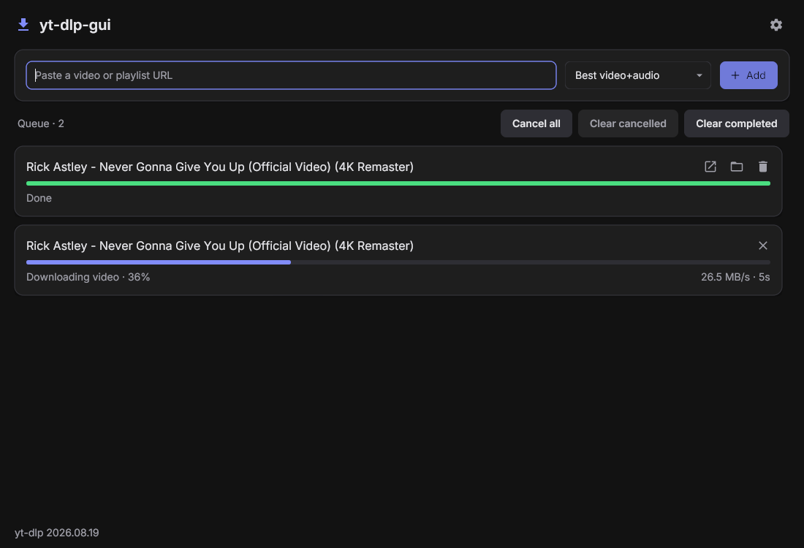
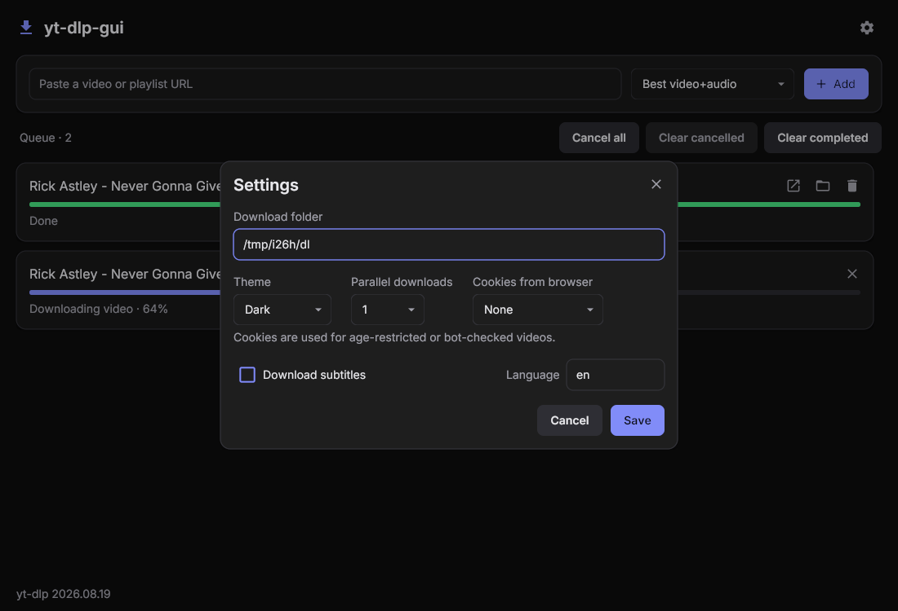
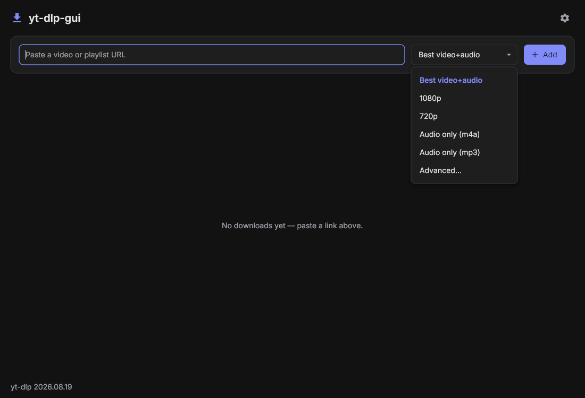
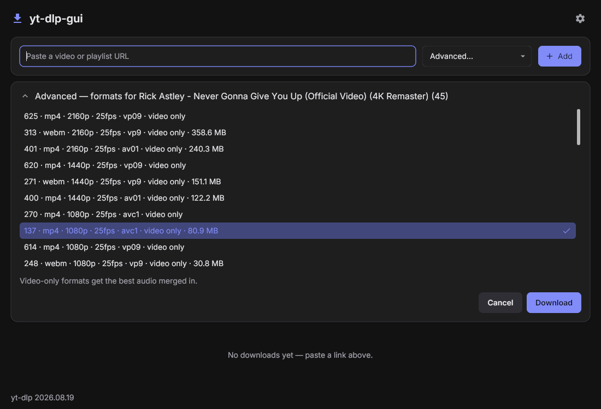
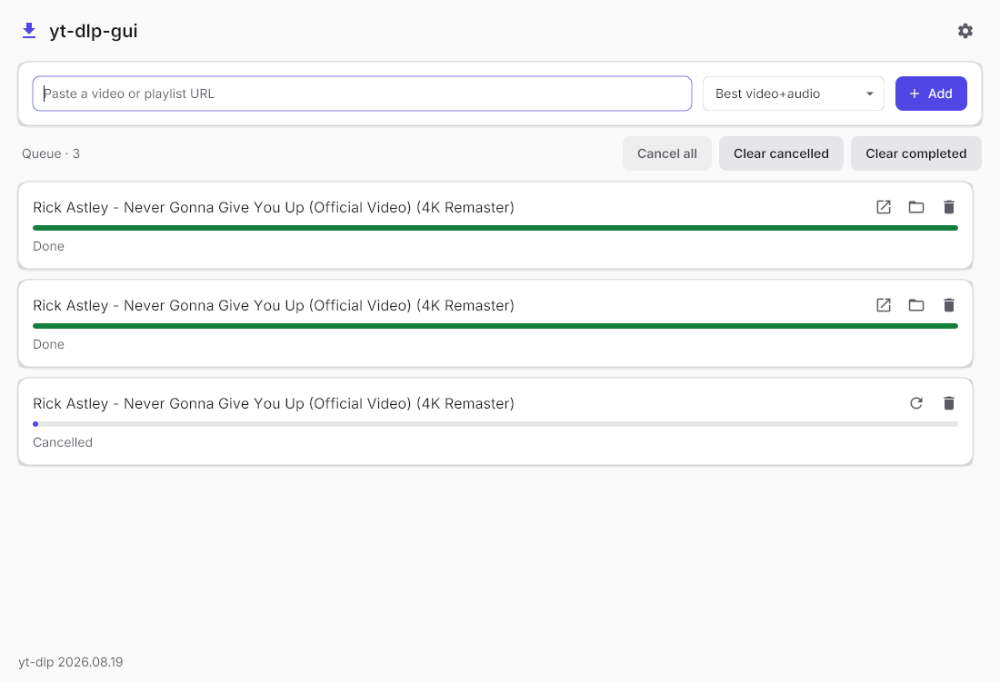

# yt-dlp-gui

A lean desktop GUI for [yt-dlp](https://github.com/yt-dlp/yt-dlp), written in Go with [Gio](https://gioui.org) (immediate-mode UI, native Wayland). Paste a video or playlist URL, pick a format preset, and watch the download queue.



It drives the system `yt-dlp` binary as a subprocess: it probes the URL first, then reads per-stream progress from yt-dlp's `--progress-template` output.

## Features

- **Format presets:** Best video+audio, 1080p, 720p, Audio only (m4a), Audio only (mp3). Video presets prefer mp4/m4a. The chosen preset is remembered.
- **Advanced...:** lists the video's real formats. A video-only pick gets the best audio merged in, which may produce `.mkv`.
- **Playlists:** a checkbox picker with select all/none. Only checked entries are queued, saved as `<folder>/<playlist title>/<NNN> - <title>.<ext>`. Playlist entries use the chosen preset; Advanced falls back to Best for playlists. Single videos are saved as `<title> [<id>].<ext>`.
- **Queue:** 1-4 parallel downloads, live progress with stages (video, audio, merging, processing), speed and ETA.
  - Cancel keeps partial files, so Retry resumes. Retry uses the current cookie and subtitle settings.
  - Remove deletes leftover partial, thumbnail and subtitle files, never the finished file.
  - Failed rows show yt-dlp's error, a hint, and expandable details.
  - Finished rows have Open file and Show in folder (via `xdg-open`).
  - Queue bar: Cancel all, Clear cancelled (also deletes their leftovers), Clear completed (files stay). Each is greyed out when it would do nothing.
  - An HTTP 403 is retried once automatically.
- **Embedding:** metadata, thumbnail and chapters are always embedded. Optional subtitles in a chosen language (default `en`): manual subs first, falling back to YouTube auto-captions, embedded with no stray `.vtt` left over. Video presets only.
- **Cookies from browser:** None, Firefox, Chromium, Brave, Chrome, Zen or Floorp. System and Flatpak installs both work; Zen and Floorp use yt-dlp's Firefox cookie reader. Useful for age-restricted or bot-checked videos.
- **Footer:** shows `yt-dlp --version`. At startup the app checks GitHub's latest yt-dlp release once and shows "update available (<tag>)" if yours is older. It never updates yt-dlp itself; use your package manager.

Developed and tested on Linux (Wayland, wlroots) only. Other platforms are untested.

## Requirements

- `yt-dlp` on `PATH`.
- `ffmpeg` and `ffprobe`, for merging and embedding.
- A JS runtime such as `deno` is recommended for YouTube (yt-dlp uses it for JS challenges).
- `xdg-open`, for Open file / Show in folder.
- To build: Go 1.27 or newer and Gio's Linux dependencies (Wayland and X11 dev libraries, libxkbcommon, EGL/Vulkan headers). See https://gioui.org/doc/install/linux.

## Install

```sh
git clone https://github.com/Ritze03/yt-dlp-gui
cd yt-dlp-gui
go build -o yt-dlp-gui . && ./yt-dlp-gui install    # install
./yt-dlp-gui install                                 # reinstall/update: re-run from a fresh build
```

Every run is a full reinstall: it copies the binary and rewrites the desktop entry. Running the *installed* copy (`~/.local/bin/yt-dlp-gui install`) has no new binary to copy; it warns and only rewrites the desktop entry.

It asks first and writes nothing until you confirm a summary of what will change (`Proceed? [y/N]`). Then it:

- copies the binary to `~/.local/bin/yt-dlp-gui` (and tells you if that directory isn't on your `$PATH`)
- writes `${XDG_DATA_HOME:-~/.local/share}/applications/yt-dlp-gui.desktop` so the app appears in launchers
- runs `update-desktop-database` on that directory, if the tool exists

There is no service: it's a normal app you start from your launcher or by running `yt-dlp-gui`.

## Uninstall

```sh
yt-dlp-gui uninstall                                 # remove (once ~/.local/bin is on $PATH)
yt-dlp-gui help
```

After a confirmation this removes the binary and the desktop entry. `~/.config/yt-dlp-gui/settings.json` is left in place.

## Usage

Paste a URL and press Add or Enter. The URL is probed first. Pick a preset from the dropdown beforehand, or choose Advanced... to select one of the video's actual formats. For a playlist, a picker opens: tick the entries you want and confirm. Downloads then run in the queue below, where each row shows its stage, speed and ETA.

## Settings

The gear icon opens a modal. Settings are saved as JSON in `~/.config/yt-dlp-gui/settings.json`. Escape or a click outside closes the modal without saving.

- Download folder (default `~/Downloads`; validated as an existing, writable directory)
- Theme: Dark or Light
- Parallel downloads: 1-4
- Cookies from browser
- Subtitles on/off and language



## Screenshots

Light theme, with the preset menu open:



Advanced format list, with a video-only format selected:



Finished and cancelled rows (Retry and Remove on the cancelled one):



## Development

```sh
go test ./...
YTDLP_LIVE=1 go test -run Live ./internal/ytdlp/ -v   # opt-in, hits YouTube
```

`scripts/headless.sh` runs the app inside a headless sway session, separate from your real Wayland session, for screenshots and UI checks. Subcommands: `start`, `run <cmd>`, `shot <out.png>`, `type`, `key`, `click X Y`, `msg`, `env`, `stop`. It needs sway, grim and wtype; `click` builds a small virtual-pointer helper with `cc` and `wayland-scanner`.

Layout: `internal/ytdlp` (subprocess, args, progress, errors), `internal/queue` (job queue), `internal/settings` (JSON persistence), `internal/ui` (Gio UI and theme).

The Inter font is embedded (`internal/ui/theme/fonts/`), under the SIL Open Font License; see `OFL.txt` there.

## License

No license specified yet.
